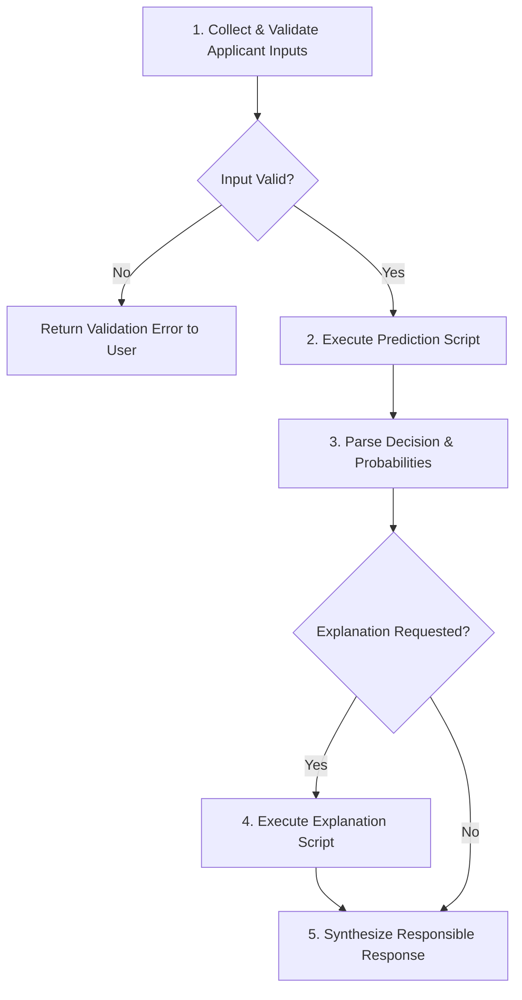

# Loan Approval AI & Explainable Credit Decisioning Skill

**Repository:** https://github.com/Borifan02/loan-approval-system

## 1. Skill Purpose & Scope

This skill enables AI coding agents (such as Claude Code, OpenAI Codex, and Cursor) to evaluate consumer loan applications, predict approval or rejection outcomes, and generate quantitative feature attributions using SHAP (SHapley Additive exPlanations).

### When to Use This Skill
- When an applicant requests preliminary loan eligibility scoring or credit risk evaluation.
- When an applicant seeks to calculate their monthly installment obligation (EMI) and disposable income buffer.
- When an applicant or loan officer requests an interpretable explanation ("Why was this loan rejected?" or "What factors supported this approval?").
- When performing batch credit risk evaluation across structured applicant records.

### When NOT to Use This Skill
- **Not for Automated Underwriting:** Do not use as a sole, automated decision-maker for commercial loan underwriting, mortgage commitments, or legally binding lending contracts.
- **Not for Missing Data:** Do not use if core financial parameters (incomes, loan amount, term, credit history) are unknown or unverified.
- **Not Financial Advice:** The outputs are statistical model estimates, not financial or legal advice.

---

## 2. Prerequisites & Environment Setup

The skill runs locally in a standard Python environment (Python 3.9+) with zero external API key requirements.

### Verify Dependencies
Check that runtime dependencies are installed:
```bash
python -c "import sklearn, pandas, shap, joblib, matplotlib; print('Dependencies OK')"
```

If dependencies are missing, install them from the package root:
```bash
pip install -r requirements-skill.txt
```

### Verify Model Artifacts
Ensure that the trained model and scaler are present and readable:
```bash
python -c "import joblib; m = joblib.load('models/rf_model.pkl'); s = joblib.load('models/scaler.pkl'); print('Model artifacts verified')"
```

---

## 3. Package Structure Reference

```
loan-approval-ai-skill/
├── SKILL.md                  # This specification document (with valid YAML frontmatter)
├── README.md                 # Package documentation and quick start
├── requirements-skill.txt    # Lightweight runtime dependencies
├── scripts/                  # Standalone execution scripts for agents
│   ├── predict.py            # Standalone prediction script
│   └── explain.py            # Standalone explanation & waterfall plot script
├── src/
│   └── loan_approval/        # Core Python package
│       ├── __init__.py       # Public API exports
│       ├── config.py         # Configuration and mathematical constants
│       ├── model_loader.py   # Thread-safe model artifact caching
│       ├── validation.py     # Input validation and business constraints
│       ├── preprocessing.py  # Log transforms, EMI calculation, and scaling
│       ├── predictor.py      # High-level inference engine
│       ├── explanation.py    # SHAP feature attribution & waterfall plotting
│       └── utils.py          # Logging and serialization helpers
├── models/
│   ├── rf_model.pkl          # Trained Random Forest classifier (150 trees)
│   ├── scaler.pkl            # Fitted StandardScaler (3 continuous log features)
│   └── metadata.json         # Model specification and training metadata
├── references/
│   ├── INPUT_SCHEMA.md       # Input data types and boundaries
│   ├── PREDICTION_GUIDE.md   # Prediction execution procedures
│   ├── MODEL_EXPLANATION.md  # Responsible interpretation of SHAP values
│   └── TROUBLESHOOTING.md    # Common errors and resolutions
└── examples/
    └── example_input.json    # Standard benchmark applicant payload
```

---

## 4. Input Schema

All applicant evaluations require a JSON payload containing the following 5 financial fields:

| Field | Type | Description | Valid Range |
|---|---|---|---|
| `ApplicantIncome` | Float | Monthly primary applicant income | `>= 0.0` (nominal currency units) |
| `CoapplicantIncome` | Float | Monthly coapplicant income | `>= 0.0` (nominal currency units) |
| `LoanAmount` | Float | Requested principal in **thousands** | `> 0.0` (e.g. 120 = 120,000 units) |
| `Loan_Amount_Term` | Float | Repayment term in months | `12.0` to `480.0` (1 to 40 years) |
| `Credit_History` | Float / Int | Guideline repayment compliance | `1` (meets) or `0` (does not) |

*Combined household income (`ApplicantIncome + CoapplicantIncome`) must be strictly greater than 0.*

### Contextual & Demographic Fields
`Gender`, `Married`, `Dependents`, `Education`, `Self_Employed`, and `Property_Area` are accepted for applicant profile completeness, but are **excluded from the active classifier** to mitigate direct demographic bias.

> **Responsible AI Notice on Fair Lending:** Excluding demographic variables from model inputs is a design step to avoid direct discrimination. However, demographic feature omission **does not guarantee compliance with the Equal Credit Opportunity Act (ECOA) or Regulation B**, because indirect proxy discrimination may persist through correlated financial variables. The system must be operated as a decision-support tool alongside human compliance review.

---

## 5. Step-by-Step Agent Workflow



### Step 1: Execute Loan Prediction
Run the prediction script from the extracted package root:
```bash
python scripts/predict.py --input examples/example_input.json
```
*Alternatively, pass inline JSON:*
```bash
python scripts/predict.py --input '{"ApplicantIncome": 5000, "CoapplicantIncome": 1500, "LoanAmount": 120, "Loan_Amount_Term": 360, "Credit_History": 1}'
```

### Step 2: Parse Prediction Output
The script prints a JSON object to `stdout`:
```json
{
  "success": true,
  "prediction": "Approved",
  "prediction_class": 1,
  "probabilities": {
    "rejected": 0.0913,
    "approved": 0.9087
  },
  "confidence": 0.9087,
  "confidence_note": "Model probability is a statistical estimate from a 150-tree Random Forest...",
  "engineered_metrics": {
    "Total_Income": 6500.0,
    "Monthly_EMI": 333.33,
    "Balance_Income": 6166.67
  }
}
```

### Step 3: Execute SHAP Explanation (If Requested)
When the applicant or operator requests reasons for the decision:
```bash
python scripts/explain.py --input examples/example_input.json
```
*Expected output includes:*
- `human_readable_summary`: Plain-English narrative explaining primary positive and negative factors.
- `positive_factors`: Attributes that supported approval.
- `negative_factors`: Attributes that increased rejection risk.
- `global_importance`: Global feature weights across the training baseline.

---

## 6. Responsible Response Formatting for AI Agents

When formulating the final response to the user, adhere strictly to these principles:
1. **State the Result Clearly:** E.g., *"Based on the applicant's financial profile, the model predicts that the loan is **Approved** with a statistical model confidence of **90.9%**."*
2. **Detail the Financial Metrics:**
   - Total Monthly Household Income: $6,500.00
   - Estimated Monthly EMI: $333.33
   - Net Balance Income Buffer: $6,166.67
3. **Present the Key Drivers (from SHAP):**
   - *Positive Factors:* Satisfactory credit history, healthy disposable income buffer.
   - *Risk Factors (if any):* High installment obligation relative to income.
4. **Mandatory Disclaimer:** Always include the following disclaimer:
   > ⚠️ **Decision-Support Notice:** This evaluation is generated by a machine learning model trained on historical data. It is a decision-support estimate and does not constitute a guaranteed loan approval, binding underwriting commitment, or professional financial advice.

---

## 7. Error Handling & Exit Codes

| Exit Code | Cause | Action Required by Agent |
|---|---|---|
| `0` | Success | Parse stdout JSON and present findings to the user. |
| `1` | Input / Validation Error | Inspect `message` in JSON output, explain which field was invalid, and prompt user for correction. |
| `2` | Environment / Artifact Error | Verify dependencies (`requirements-skill.txt`) or check artifact files in `models/`. |

---

## 8. Limitations & Security Policy

- **Decision-Support Tool Only:** All predictions are preliminary assessments requiring certified human underwriter review.
- **Artifact Security:** Models are stored in `pickle` / `joblib` format. Only load trusted model artifacts provided within this package.
- **Privacy Assurance:** Applicant data is evaluated strictly in-memory; no applicant information is written to disk or transmitted over the network.
- **Credit History Sensitivity:** The model places high empirical weight (~55.8%) on `Credit_History`. An applicant without a verified positive repayment history (`Credit_History = 0`) will almost always be predicted as Rejected regardless of high income.

---

## 9. Source Repository & Attribution

- **GitHub Repository:** https://github.com/Borifan02/loan-approval-system
- **Original Baseline Prototype & Training Notebook:** Copyright (c) 2024 Gianluca Sposito, PhD (MIT License)
- **Production Architecture, CLI, & Agensi AI Skill:** Copyright (c) 2026 Loan Approval System Contributors (MIT License)
