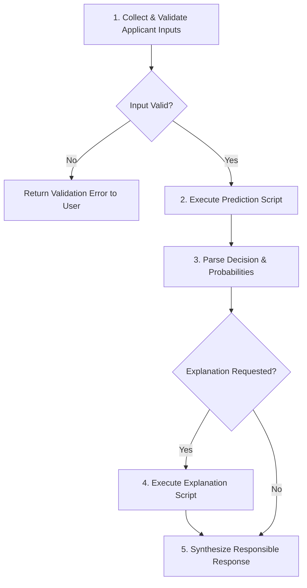

# Loan Approval AI & Explainable Credit Decisioning Skill

## 1. Skill Purpose & Scope

This skill enables AI coding agents (such as Claude Code, OpenAI Codex, and Cursor) to evaluate consumer loan applications, predict approval or rejection outcomes, and generate quantitative feature attributions using SHAP (SHapley Additive exPlanations).

### When to Use This Skill
- When a user asks to predict whether a loan application will be approved or rejected.
- When an applicant seeks to understand their credit capacity, monthly installment burden (EMI), or disposable income buffer.
- When a user requests an explainable justification ("Why was this loan rejected?" or "What factors supported this approval?").
- When performing batch credit risk evaluation across applicant records.

### When NOT to Use This Skill
- Do not use for commercial loan underwriting, mortgage refinancing guarantees, or legally binding lending commitments.
- Do not use if applicant financial parameters (incomes, loan amount, term, credit history) are unknown or unverified.

---

## 2. Prerequisites & Environment Setup

The skill runs locally in a standard Python environment (Python 3.9+) with zero external API key requirements.

### Verify Environment & Dependencies
Check that dependencies are installed:
```bash
python -c "import sklearn, pandas, shap, joblib; print('Dependencies OK')"
```

If dependencies are missing, install them:
```bash
pip install -r requirements.txt
```

### Verify Model Artifacts
Ensure that the trained model and scaler are present:
```bash
python -m cli.main model-info
```
*Expected output:* A JSON object with `"success": true`, displaying `rf_model.pkl` and `scaler.pkl` paths and metadata.

---

## 3. Project Structure Reference

```
loan-approval-system/
├── models/
│   ├── rf_model.pkl            # Trained Random Forest classifier (150 trees)
│   ├── scaler.pkl              # Fitted StandardScaler (Total Income, EMI, Balance Income)
│   └── metadata.json           # Model specification and training metadata
├── src/
│   └── loan_approval/          # Decoupled core Python package
│       ├── config.py           # Configuration and mathematical constants
│       ├── model_loader.py     # Thread-safe model artifact caching
│       ├── validation.py       # Input validation and business constraints
│       ├── preprocessing.py    # Log transforms, EMI calculation, and scaling
│       ├── predictor.py        # High-level inference engine
│       └── explanation.py      # SHAP feature attribution & waterfall plotting
├── cli/
│   └── main.py                 # Command-line interface dispatcher
└── agensi-skill/
    ├── SKILL.md                # This specification
    ├── scripts/
    │   ├── predict.py          # Standalone prediction CLI script
    │   └── explain.py          # Standalone explanation CLI script
    └── references/
        ├── INPUT_SCHEMA.md     # Input data types and boundaries
        ├── PREDICTION_GUIDE.md # Prediction execution procedures
        ├── MODEL_EXPLANATION.md# Responsible interpretation of SHAP values
        └── TROUBLESHOOTING.md  # Common errors and resolutions
```

---

## 4. Input Schema

All applicant evaluations require a JSON payload containing the following 5 financial fields:

| Field | Type | Description | Valid Range |
|---|---|---|---|
| `ApplicantIncome` | Float | Monthly primary applicant income | `>= 0.0` (USD) |
| `CoapplicantIncome` | Float | Monthly coapplicant income | `>= 0.0` (USD) |
| `LoanAmount` | Float | Requested principal in **thousands** | `> 0.0` (e.g. 150 = $150,000) |
| `Loan_Amount_Term` | Float | Repayment term in months | `12.0` to `480.0` |
| `Credit_History` | Float / Int | Guideline repayment compliance | `1` (meets) or `0` (does not) |

*Combined household income (`ApplicantIncome + CoapplicantIncome`) must be > $0.*

### Optional Demographic Fields
`Gender`, `Married`, `Dependents`, `Education`, `Self_Employed`, `Property_Area` are accepted for applicant completeness, but are **excluded from the active classifier** to comply with fair lending principles (ECOA).

---

## 5. Step-by-Step Agent Workflow



### Step 1: Execute Loan Prediction
Run the prediction script using the applicant payload:
```bash
python agensi-skill/scripts/predict.py --input agensi-skill/examples/example_input.json
```
*Alternatively, pass inline JSON:*
```bash
python agensi-skill/scripts/predict.py --input '{"ApplicantIncome": 5000, "CoapplicantIncome": 1500, "LoanAmount": 120, "Loan_Amount_Term": 360, "Credit_History": 1}'
```

### Step 2: Parse Prediction Output
The script prints a JSON object to `stdout`:
```json
{
  "success": true,
  "prediction": "Approved",
  "prediction_class": 1,
  "probabilities": {
    "rejected": 0.0913,
    "approved": 0.9087
  },
  "confidence": 0.9087,
  "confidence_note": "Model probability is a statistical estimate...",
  "engineered_metrics": {
    "Total_Income": 6500.0,
    "Monthly_EMI": 333.33,
    "Balance_Income": 6166.67
  }
}
```

### Step 3: Execute SHAP Explanation (If Requested)
When the user requests an explanation or reasons for the outcome:
```bash
python agensi-skill/scripts/explain.py --input agensi-skill/examples/example_input.json
```
*Expected output includes:*
- `human_readable_summary`: Plain-English narrative explaining the primary positive and negative factors.
- `positive_factors`: List of attributes that favored approval.
- `negative_factors`: List of attributes that increased rejection risk.
- `global_importance`: Overall feature weights across all training records.

---

## 6. Responsible Response Formatting for AI Agents

When formulating the final response to the user, follow these communication rules:
1. **State the Result Clearly:** E.g., *"Based on the applicant's financial profile, the model predicts that the loan is **Approved** with a model probability of **90.9%**."*
2. **Detail the Financial Metrics:**
   - Total Monthly Household Income: $6,500.00
   - Estimated Monthly EMI: $333.33
   - Net Balance Income Buffer: $6,166.67
3. **Present the Key Drivers (from SHAP):**
   - *Positive Factors:* Satisfactory credit history, healthy disposable income buffer.
   - *Risk Factors (if any):* High debt-to-income ratio or shorter loan duration.
4. **Mandatory Disclaimer:** Always include the following disclaimer:
   > ⚠️ **Disclaimer:** This analysis is generated by a machine learning decision-support model trained on historical data. It does not constitute a formal lending decision, credit guarantee, or professional financial advice.

---

## 7. Error Handling & Exit Codes

| Exit Code | Cause | Action Required by Agent |
|---|---|---|
| `0` | Success | Parse stdout JSON and present findings to the user. |
| `1` | Validation Error | Inspect `message` in JSON output, explain which field was invalid, and prompt user for correction. |
| `2` | Environment / Model Error | Check dependencies or confirm model files exist in `models/`. |

---

## 8. Limitations & Security Policy

- **No Data Retention:** No applicant personal information is saved, logged to persistent disk, or transmitted to external endpoints.
- **Fair Lending Design:** Demographic variables are deliberately omitted from the model to avoid gender, marital status, or educational bias.
- **Credit History Sensitivity:** The model places high empirical weight (~55.8%) on `Credit_History`. An applicant without a verified positive repayment history will almost always be predicted as Rejected regardless of high income.
