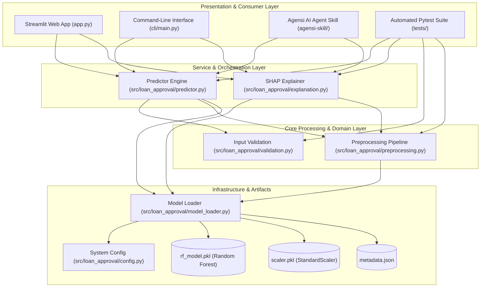
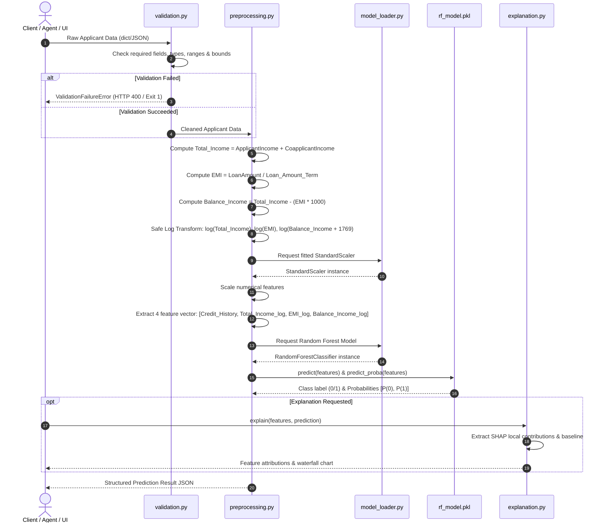

# System Architecture: Loan Approval AI & Agent Skill

## 1. Overview and Design Principles

The Loan Approval Prediction System is designed as a modular, production-grade machine learning application and a headless AI Agent Skill compatible with Agensi.io, Claude Code, OpenAI Codex, and Cursor.

### Core Architectural Principles
1. **Decoupled Prediction Core:** The machine learning prediction and explainability engine is completely decoupled from any user interface (Streamlit, CLI, or agent). UI layers act strictly as consumers of the core Python engine.
2. **Deterministic & Safe Preprocessing:** All mathematical transformations (e.g. logarithmic scaling, EMI computation, boundary clamping) enforce strict mathematical domain safeguards to prevent `NaN`, `-inf`, or division-by-zero errors.
3. **Fail-Fast Validation:** All input payloads (whether from web forms, CLI arguments, or AI agent tool calls) are validated against a strict schema with clear, actionable error messages before reaching the ML pipeline.
4. **Resilient Explainability:** SHAP TreeExplainer operations are thread-safe, handle multi-output shape variations defensively, and provide fallback heuristic contributions if SHAP computation encounters environment constraints.
5. **Zero External API Dependency:** The system operates 100% locally with zero cloud or API key dependencies, preserving applicant privacy and operational autonomy.

---

## 2. High-Level System Architecture

---

## 3. Data Processing and Inference Pipeline

The following sequence illustrates the flow of an applicant evaluation request:

---

## 4. Component Responsibilities

### 4.1. `src/loan_approval/config.py`
- Resolves absolute filesystem paths dynamically (independent of current working directory).
- Defines default model and scaler filenames.
- Encapsulates mathematical constants (e.g. `BALANCE_INCOME_OFFSET = 1769.0`, epsilon guards).
- Defines feature column names and expected ordering.

### 4.2. `src/loan_approval/model_loader.py`
- Implements thread-safe singleton loading for `rf_model.pkl` and `scaler.pkl`.
- Prevents disk I/O bottlenecks during concurrent or high-frequency requests.
- Validates model artifact integrity and feature compatibility upon startup.
- Emits human-readable diagnostics if model artifacts are corrupted or missing.

### 4.3. `src/loan_approval/validation.py`
- Validates raw input dictionaries against strict data constraints.
- Handles legacy edge cases:
  - Supports string dependents (e.g., `"0"`, `"1"`, `"2"`, `"3+"` -> normalized integer `0, 1, 2, 3`).
  - Rejects negative incomes or non-positive loan amounts.
  - Rejects invalid loan terms (must be between 12 and 480 months).
  - Validates credit history values (`0` or `1`, or boolean representations).
- Returns typed validation results with specific field error details.

### 4.4. `src/loan_approval/preprocessing.py`
- Generates domain features:
  - `Total_Income = ApplicantIncome + CoapplicantIncome`
  - `EMI = LoanAmount / Loan_Amount_Term`
  - `Balance_Income = Total_Income - (EMI * 1000)`
- Applies safe logarithmic transformations:
  - Enforces `max(value, epsilon)` to prevent `-inf`.
  - Shifts `Balance_Income` by `1769.0` (with defensive clamping `max(Balance_Income + 1769, 1.0)`).
- Standardizes numerical features using the pre-fitted `StandardScaler`.
- Assembles the exact 4-feature dataframe required by the Random Forest model:
  `['Credit_History', 'Total_Income_log', 'EMI_log', 'Balance_Income_log']`.

### 4.5. `src/loan_approval/predictor.py`
- High-level prediction coordinator.
- Computes:
  - Binary decision: `Approved` (Class 1) or `Rejected` (Class 0).
  - Calibrated probability estimates for both classes: `P(Approved)` and `P(Rejected)`.
  - Confidence metric (clearly labeled as statistical model probability, not guaranteed lending truth).
- Formats uniform JSON-serializable responses for CLI, UI, and AI Agent skill consumption.

### 4.6. `src/loan_approval/explanation.py`
- Encapsulates SHAP TreeExplainer operations.
- Generates:
  - Per-feature Shapley contribution values for the specific applicant.
  - Positive contributors (factors driving approval).
  - Negative contributors (factors driving rejection).
  - Matplotlib figure generation for waterfall plots (headless and thread-safe).
  - Base expected value and model output margin.

### 4.7. `cli/main.py`
- Provides non-interactive command-line execution for AI coding agents and automated pipelines:
  - `python -m cli.main predict --input <path_or_json>`
  - `python -m cli.main explain --input <path_or_json>`
  - `python -m cli.main model-info`
  - `python -m cli.main batch --input <csv_path> --output <results_json>`
- Outputs clean, parseable JSON on `stdout` with POSIX-compliant exit codes (`0` success, `1` validation error, `2` system/model error).

### 4.8. `agensi-skill/`
- Agensi-compatible skill package:
  - `SKILL.md`: Root instructions for AI coding agents with YAML frontmatter.
  - `scripts/predict.py`: Lightweight standalone execution script.
  - `scripts/explain.py`: Lightweight explanation generation script.
  - `references/`: Detailed schemas, prediction guides, and responsible AI instructions.

---

## 5. Security & Responsible AI Architecture

- **No Demographic Bias in Decision Loop:** Demographic attributes (`Gender`, `Married`, `Education`, `Self_Employed`, `Property_Area`) are not passed to the trained classifier.
- **Privacy Preservation:** No personal applicant details or financial records are stored or transmitted across external networks.
- **Explainability Transparency:** Decisions are accompanied by quantitative SHAP feature contributions, preventing black-box rejections.
