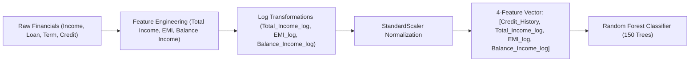

# Model Documentation & Technical Specifications

## 1. Executive Summary
The loan approval model is an ensemble **Random Forest Classifier** designed to evaluate retail consumer credit risk. It outputs binary classifications (`Approved` vs `Rejected`) accompanied by calibrated probability estimates and SHAP local feature attributions.

---

## 2. Dataset & Training Methodology

### Training Data Provenance
- **Dataset:** Kaggle Loan Prediction Dataset (`data/Loan_dataset_train.csv`)
- **Sample Size:** 614 total records (422 Approved [68.7%], 192 Rejected [31.3%])
- **Cross-Validation:** 10-fold Stratified Cross-Validation (`StratifiedKFold(n_splits=10, shuffle=True, random_state=27)`)
- **Optimization Metric:** F1-score (harmonic mean of precision and recall) to balance class imbalance

### Model Comparison & Selection
During initial development in `Loan_prediction_main.ipynb`, four machine learning families were evaluated:
| Model Family | Validation F1-Score | Interpretability | Decision |
|---|---|---|---|
| K-Nearest Neighbors (KNN) | 0.8424 | Low (distance-based) | Baseline |
| Support Vector Machine (SVM) | 0.8610 | Low (kernel hyperplane) | Rejected |
| XGBoost Classifier | 0.8645 | Moderate (boosted trees) | Rejected |
| **Random Forest Classifier** | **0.8680** | **High (decision trees & SHAP)** | **Selected** |

*Reason for Selection:* Random Forest achieved the highest F1-score while offering superior tree interpretability, stability against outliers, and seamless compatibility with TreeExplainer algorithms.

---

## 3. Feature Engineering & Preprocessing Pipeline

The model utilizes strictly 4 features derived from financial capability and credit guidelines compliance:

### Mathematical Definitions
1. **Total Income:**
   $$\text{Total\_Income} = \text{ApplicantIncome} + \text{CoapplicantIncome}$$
2. **Equated Monthly Installment (EMI):**
   $$\text{EMI} = \frac{\text{LoanAmount}}{\text{Loan\_Amount\_Term}}$$
   $$\text{Monthly Installment (USD)} = \text{EMI} \times 1000$$
3. **Balance Income (Disposable Buffer):**
   $$\text{Balance\_Income} = \text{Total\_Income} - \text{Monthly Installment}$$
4. **Log Transformations:**
   - $\text{Total\_Income\_log} = \ln(\max(\text{Total\_Income}, 10^{-4}))$
   - $\text{EMI\_log} = \ln(\max(\text{EMI}, 10^{-4}))$
   - $\text{Balance\_Income\_log} = \ln(\max(\text{Balance\_Income} + 1769.0, 1.0))$
   *(Note: Constant $c = 1769.0$ shifts the empirical minimum negative balance income of -$1,768 into the strictly positive logarithmic domain).*
5. **Feature Scaling (StandardScaler):**
   - Fitted on log-transformed numerical features:
     - `Total_Income_log`: $\mu = 8.6694, \sigma = 0.5447$
     - `EMI_log`: $\mu = -0.9443, \sigma = 0.5597$
     - `Balance_Income_log`: $\mu = 8.8822, \sigma = 0.5663$

---

## 4. Hyperparameters & Artifact Specifications

- **Estimator:** `sklearn.ensemble.RandomForestClassifier`
- **Number of Estimators:** 150
- **Random State:** 42
- **File Artifacts:**
  - `models/rf_model.pkl`: ~687 KB serialized binary
  - `models/scaler.pkl`: ~975 B fitted scaler
  - `models/metadata.json`: JSON specification schema

---

## 5. Global Feature Importance (Gini Impurity)

| Feature Name | Description | Gini Importance |
|---|---|---|
| `Credit_History` | Meets repayment guidelines (1.0 vs 0.0) | **55.85%** |
| `Total_Income_log` | Log household earning capacity | **17.25%** |
| `Balance_Income_log` | Log disposable cash buffer | **14.95%** |
| `EMI_log` | Log monthly installment burden | **11.96%** |

---

## 6. Ethical Rationale for Excluding Demographic Attributes
In accordance with fair lending principles (e.g. US Equal Credit Opportunity Act - ECOA):
- **Gender & Marital Status:** Excluded to prevent discrimination against female applicants and single/non-traditional household structures.
- **Education & Self-Employment:** Excluded to avoid penalizing vocational careers, self-employed contractors, and non-degree holders.
- **Property Area:** Excluded to eliminate geographic redlining risks.
